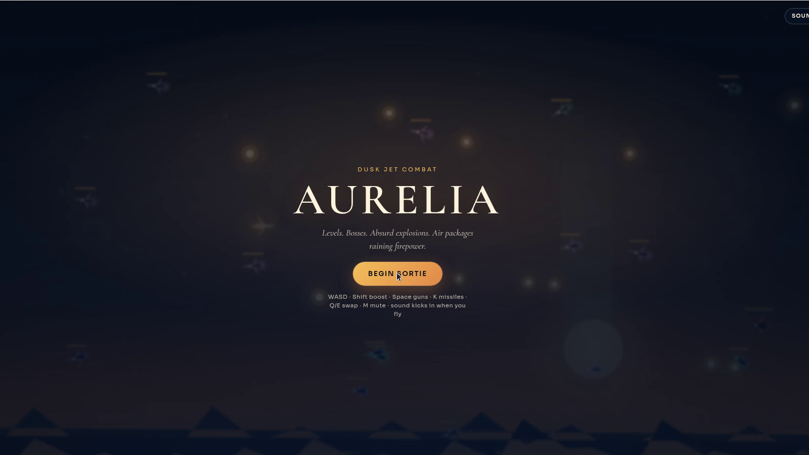
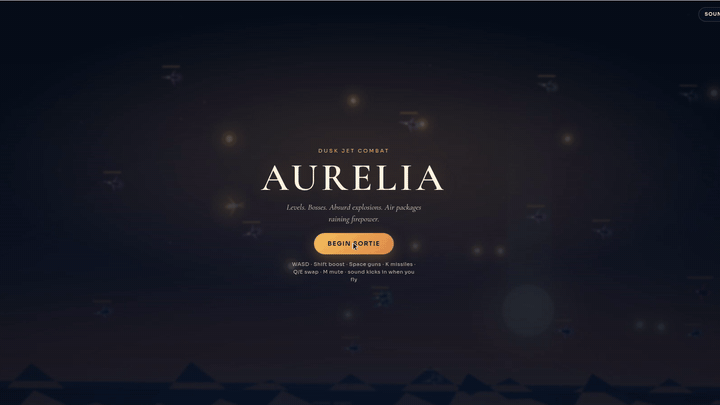
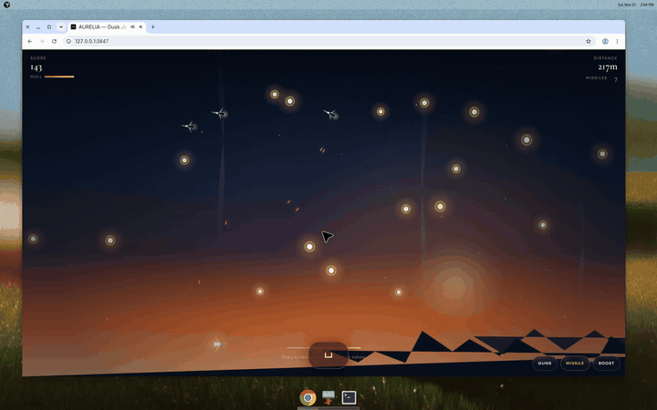
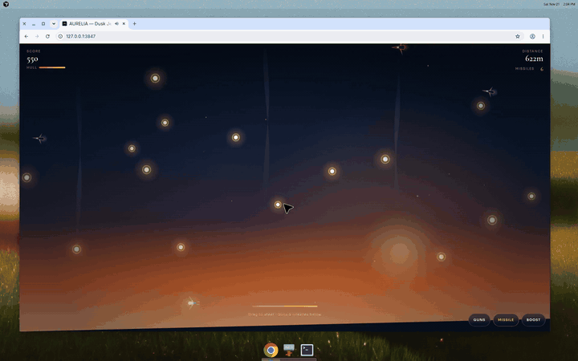
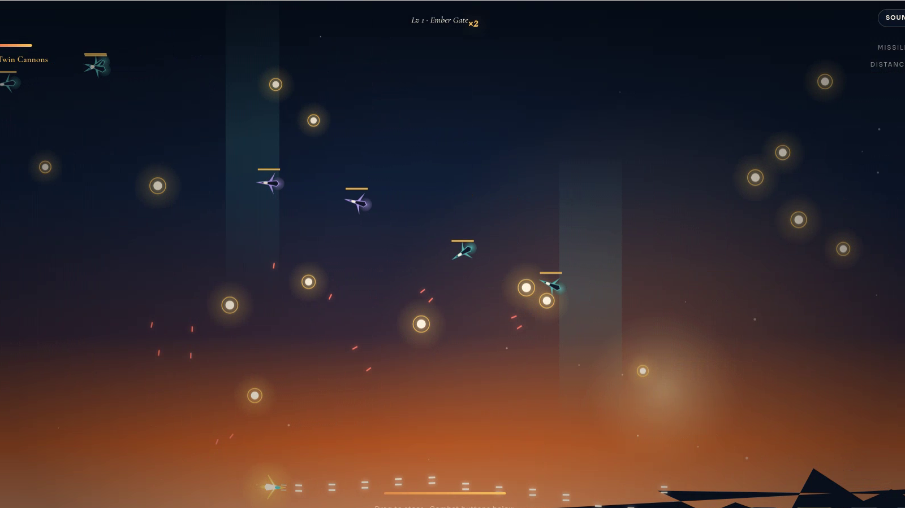
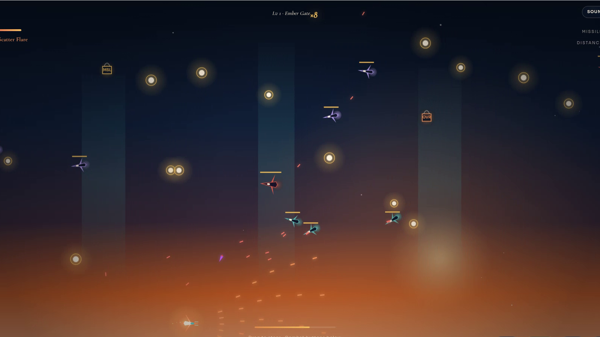

<p align="center">
  
</p>

<h1 align="center">AURELIA</h1>

<p align="center">
  <strong>Dream skies. Real dogfights. Absurd explosions.</strong><br/>
  A browser-native dusk jet combat game — levels, bosses, weapon unlocks, air packages, and jet upgrades.
</p>

<p align="center">
  <a href="#play-now"></a>
  
  
  
</p>

---

## Trailer Reel

Three **different** live captures from real runs — title, twin-cannon dogfight, then missiles / packages / weapon swaps.

| Title Call | Twin Cannon Dogfight | Missiles & Packages |
| :---: | :---: | :---: |
|  |  |  |

<p align="center">
  
  
</p>

---

## Why players stay airborne

AURELIA looks like a dream and hits like an arcade cabinet.

- **Open dusk skies** — no invisible crash walls, only enemies and incoming fire
- **Five primary weapons** — Twin Cannons, Scatter Flare, Plasma Bloom, Rail Lance, Nova Cascade
- **Unlock a new gun every 5 kills** — or snatch one from a drifting air package
- **Air packages** drop loot mid-flight: weapons, missiles, hull repair, upgrades, overcharge
- **Four story levels + bosses** — Sol Sovereign, Twin Eclipse, Obsidian Leviathan, Aurelia Null
- **Jet upgrades** after each boss — hull, fire rate, thrusters, magazines, warheads, magnet
- **Absurd multi-ring explosions** on every wreck — the sky remembers

---

## Campaign Map

| Level | Codename | Boss | Reward |
| --- | --- | --- | --- |
| 1 | Ember Gate | Sol Sovereign | Titanium Skin |
| 2 | Mirage Run | Twin Eclipse | Overclocked Guns |
| 3 | Titan Wake | Obsidian Leviathan | Cataclysm Tips |
| 4 | Nightfall | Aurelia Null | Dawn Thrusters |

After Null falls, the sortie never ends — Nightfall endless storm.

---

## Controls

| Input | Action |
| --- | --- |
| **WASD** / Arrows | Steer |
| **Shift** | Afterburner boost |
| **Space** / J / Z / Click | Fire current weapon |
| **K** / F / X / Right-click | Homing missile |
| **Q** / E / Tab | Cycle unlocked weapons |
| **P** / Esc | Pause |

Touch players get on-screen **Guns · Missile · Swap · Boost**.

---

<a id="play-now"></a>

## Play now

```bash
npm install
npm run dev
```

Then open the local URL (default `http://127.0.0.1:3847`).

```bash
npm run build
npm run preview
```

Zero accounts. Zero downloads beyond the browser. Clone → install → fly.

---

## Arsenal

| Weapon | Feel |
| --- | --- |
| Twin Cannons | Reliable dual stream |
| Scatter Flare | Wide dream shotgun |
| Plasma Bloom | Fat orbs that detonate |
| Rail Lance | Piercing dusk beam-shot |
| Nova Cascade | Absurd spiral barrage |

Missiles track. Overcharge packages make the guns go feral.

---

## Tech

- **Vite + TypeScript**
- Single high-performance **Canvas 2D** loop
- **Full procedural audio** — dusk music bed, engine roar, guns, missiles, mega-booms (press **M** to mute)
- Local high-score persistence

Built to feel handmade, not scaffolded.

---

## Repo vibe

This is a finished slice of a game — not a template dump.

Star it if the dusk hit. Fork it if you want to add a fifth boss. Open an issue if a Titan clipped you unfairly.

<p align="center">
  
</p>

<p align="center"><em>Ride the dusk winds. Empty the magazines. Make the horizon bloom.</em></p>
